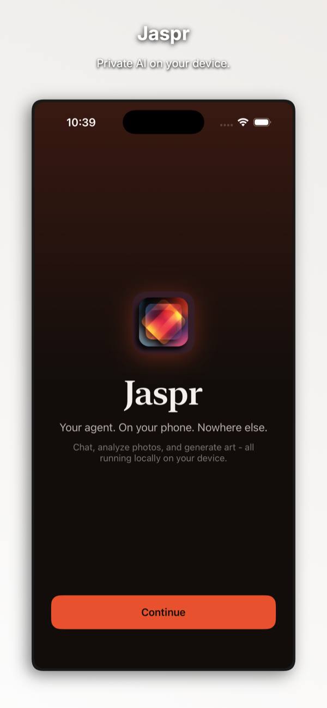
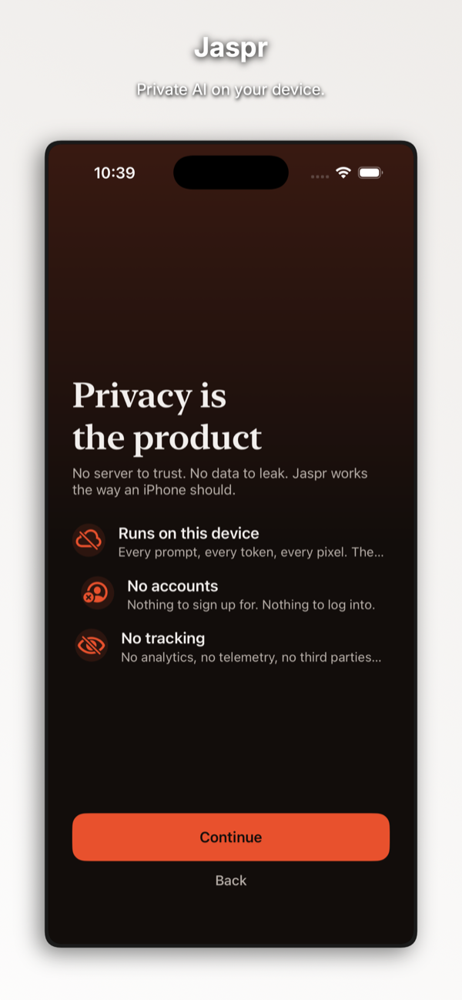

# Jaspr

Run open-source AI chat, vision, and image models on your iPhone.

Jaspr is a private AI assistant that runs open-source language, vision and image models on your iPhone and iPad. It is for anyone who wants AI help without an account, a cloud server or their conversations leaving the device. Free to download. Optional one-time Jaspr Pro unlock, $9.99.

- Website: https://emrldlabs.com/apps/jaspr/
- App Store: https://apps.apple.com/us/app/jaspr/id6762830613
- Support: https://emrldlabs.com/jaspr/support/ or open an issue here
- Email: hello@emrldlabs.com
- Privacy: https://www.notion.so/scottmanley/Jaspr-Privacy-Policy-349470c8ef41804498eefcc3ff8bf970

## About this repository

The app's source code is not public. This repository is used for support: please open an issue for bug reports and questions.
